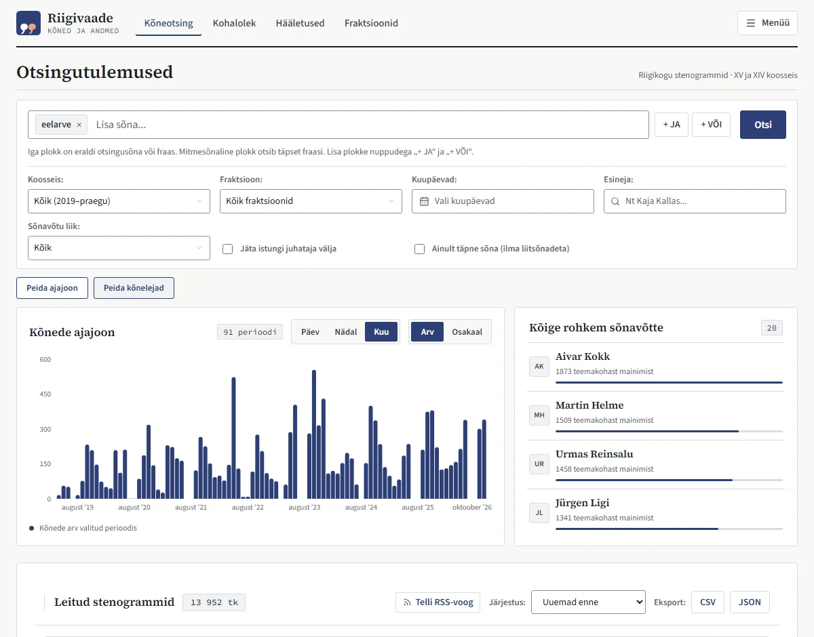
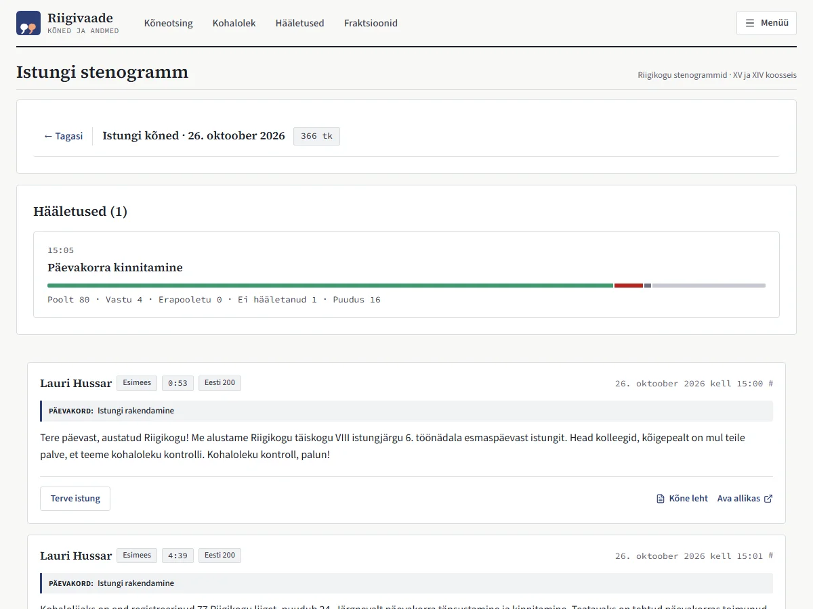
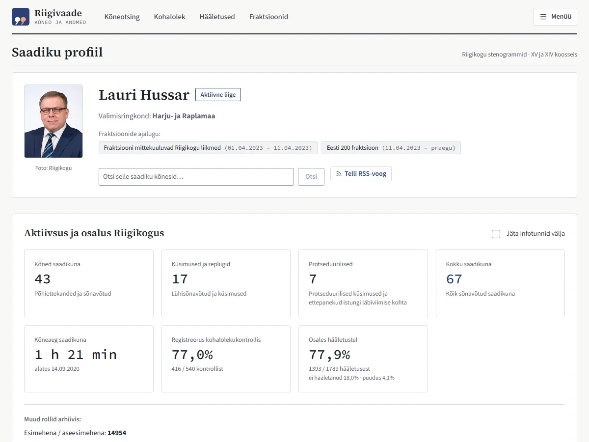
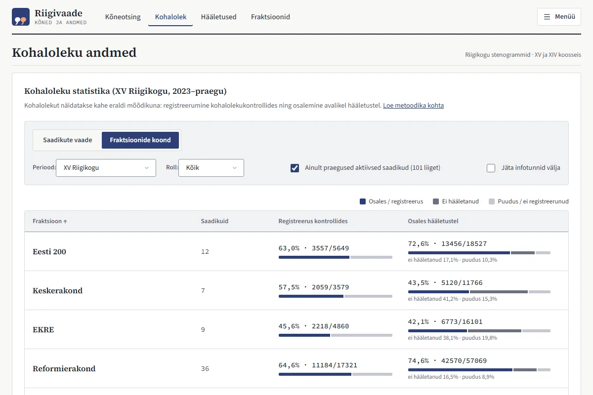
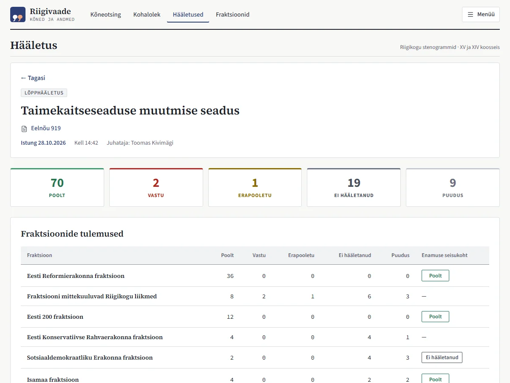
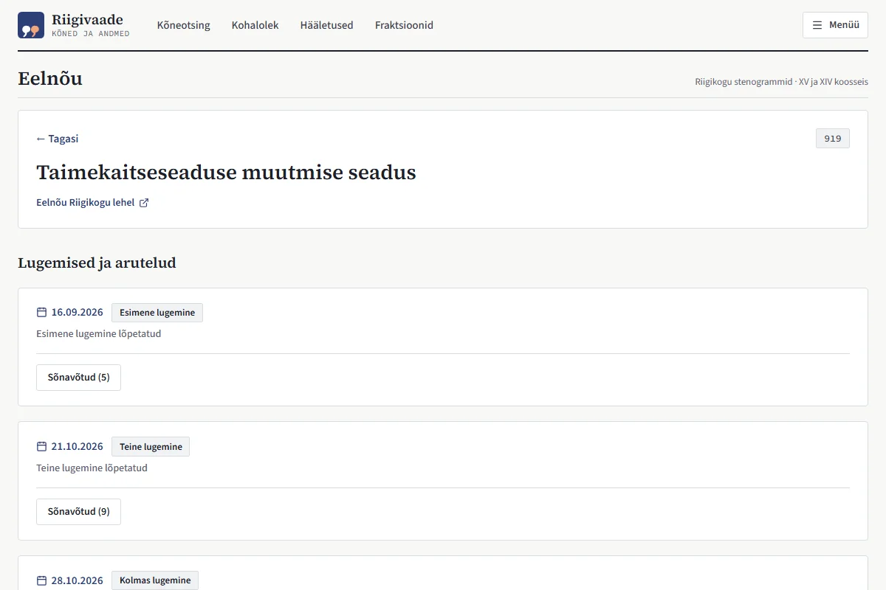
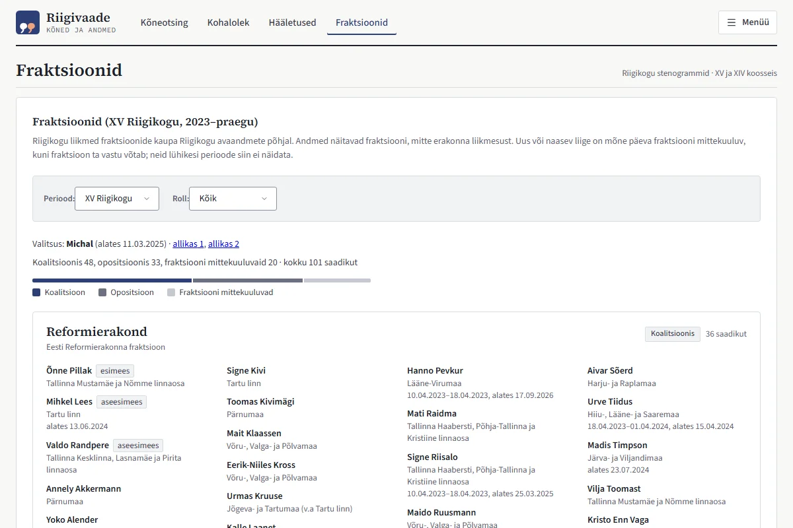

# Riigivaade – Riigikogu Stenogram Search

[](https://github.com/spaceminx/riigikogu-stenogram-search/actions/workflows/ci.yml)

[Eestikeelne README](README.et.md)

[Riigivaade](https://www.riigivaade.me) is an impartial public site about the Estonian Parliament (Riigikogu): full-text search of plenary stenograms, sittings, members' activity and attendance, votes, bills and factions. The data comes from the Riigikogu open data API (CC BY-SA), covers the XIV and XV Riigikogu (from April 2019) and is updated daily.

---

## What's on the site

Each screenshot opens the same page on the live site.

### Speech search

[](https://www.riigivaade.me/otsing?q=eelarve)

Searches base word forms (lemmas), so "eelarve" also finds "eelarvest". Words in one block must all occur, blocks are alternatives (`+ JA`, `+ VÕI`) and a multi-word block is an exact phrase. Filters: membership, faction, dates, speaker and speech type, optionally without the chair of the sitting or without compound words. Optional panels show mentions over time (day, week or month; count or share) and the members who mention the topic most. Every result opens in the context of its sitting; results download as CSV or JSON, and every search has an RSS feed.

### Sitting

[](https://www.riigivaade.me/istung/2026-10-26)

The whole stenogram of a sitting in order, with its votes, the video of each speech and a link to the source. A single speech also has its own page with a permanent link (`/kone/<id>`).

### Member

[](https://www.riigivaade.me/saadik/64c0141f-371b-4520-8a50-09e65231f775)

Activity and participation, speeches as a member, minister or chair, attendance and voting while in the coalition and in opposition, speeches per year, attendance per membership, how often the member voted with the faction majority (with the votes that differed) and the member's speeches, with an RSS feed.

### Attendance

[](https://www.riigivaade.me/kohalolek?att_tab=factions)

Registration in attendance checks and participation in votes per member or per faction, by membership, faction and role, optionally without question time.

### Votes

[](https://www.riigivaade.me/haaletus/f00ae6f6-bc70-4be6-8e1f-9e000b5d4f0f)

Every plenary vote, searchable by title or bill and filterable by date and type. A vote shows the result, the result of each faction and every member's vote; secret votes show only the totals.

### Bill

[](https://www.riigivaade.me/eelnou/1fdf1be7-b35c-44bf-9ed8-ab5d309838fd)

The readings and debates of a bill with their votes and speeches.

### Factions

[](https://www.riigivaade.me/fraktsioonid)

The members of each faction per membership, the seats in the coalition and in opposition, the chairs and vice-chairs, and the former members.

### Also

- **Dashboard** (`/`): example topics, speeches per month, the latest sittings, the most active speakers and a calendar for opening any sitting.
- **Data and privacy** (`/andmed`): who runs the site, what is collected about visitors, the open data downloads and the impartiality principles. The methodology is available from every page.

The data is also published as a monthly open data release on [GitHub Releases](https://github.com/spaceminx/riigikogu-stenogram-search/releases) (see [docs/open-data.md](docs/open-data.md)). The screenshots are made with `node scripts/capture_readme_screenshots.mjs`.

---

## Under the hood

- **Lemma index:** speeches are lemmatised with EstNLTK; search runs on a lemma index with query expansion and phrase matching.
- **Daily pipeline:** a server job fetches new stenograms, votes, attendance and agenda, checks them against the Riigikogu API, backs them up to Backblaze B2 and updates the database under one lock.
- **Permanent links:** speeches keep stable keys and aliases, so links keep working after the Riigikogu edits a stenogram.
- **Transparency:** `/system/status` reports the data's freshness, and the methodology explains how attendance, speech types and unedited stenograms are counted.

---

## Tech Stack

| Layer | Technologies |
| :--- | :--- |
| **Frontend** | React 19, Vite, Recharts, ESLint 10, Prettier |
| **Backend & API** | Python 3.10+, FastAPI, Uvicorn, SQLAlchemy, SQLite |
| **NLP & Lemmatization** | EstNLTK, NLTK |
| **Data Pipelines & Storage** | Server cron, Backblaze B2, Requests, GitHub Actions |
| **Deployment & Containers** | Docker, Docker Compose, Cloudflare Tunnel |
| **Code Quality & CI** | Ruff (Python), ESLint + Prettier (JS/React), Pytest, Dependabot, GitHub Actions CI |

---

## Documentation

- [Development](docs/development.md): running locally, tests, linting, Python dependency updates, E2E tests, live and upstream API checks
- [Deployment & Operations](docs/operations.md): deploy, schema changes, server daily pipeline, cron, database backup
- [Data Maintenance](docs/data-maintenance.md): database rebuild, history backfill, voting initial load, UUID repair, B2 sync
- [Open Data](docs/open-data.md): building, publishing and the monthly release
- [API](docs/api.md): key endpoints

---

## Project Structure

```text
riigikogu-stenogram-search/
├── .github/            # CI, deploy, live API check and fallback pipeline workflows; Dependabot
├── docs/               # Development, operations, data maintenance, open data and API docs; README screenshots
├── scripts/            # Data pipeline, fetchers, B2 sync, repairs, releases, backup
├── src/
│   ├── api/            # FastAPI app, routes, search and attendance queries
│   ├── data/           # Static reference data (governments)
│   ├── fetch_models/   # Pydantic models for upstream Riigikogu API responses
│   ├── load/           # SQLAlchemy models, migrations, indexes, JSONL loader
│   ├── transform/      # EstNLTK lemmatizer and term index builder
│   └── frontend/       # React + Vite app (Vercel)
│       ├── e2e/        # Playwright tests and recorded API fixtures
│       ├── src/        # Components, routes, lib, styles
│       └── test/       # Unit tests (node --test)
├── tests/              # Pytest backend, API and pipeline tests
├── config.py           # Global configuration & dynamic membership dates
├── docker-compose.yml  # Backend and one-off pipeline containers
├── Dockerfile          # Multi-stage production backend image
├── requirements.in     # Direct Python runtime dependencies
├── requirements.txt    # Locked Python runtime dependencies (generated by uv)
└── requirements-dev.txt
```

---

## License

This project is open source and available under the [MIT License](LICENSE).
